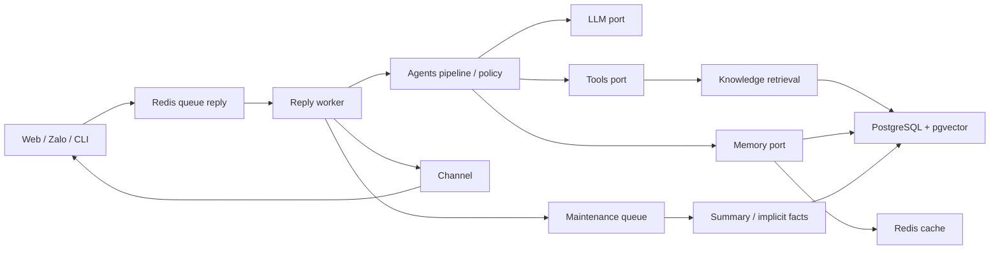

# Đánh giá kỹ thuật CP Assistant — 12/10/2026

**Kết luận: nền tảng kỹ thuật khá tốt, nhưng chưa đủ điều kiện phát hành production.**

Đây là một chatbot có kiến trúc và công cụ nghiên cứu tương đối nghiêm túc. Điểm yếu lớn nhất hiện tại nằm ở các bất biến xuyên suốt hệ thống: lọc đầu ra, lưu lịch sử, tính đúng của memory, đồng nhất embedding, kiểm soát chi phí và nghiệm thu chất lượng. Các module có thể đạt test riêng nhưng khi nối lại vẫn tạo ra hành vi sai.

Nếu tôi chịu trách nhiệm ký phát hành, tôi sẽ yêu cầu xử lý các mục P1 và hoàn thành Gate A/B/C trước khi mở cho nhiều người dùng. Tôi không đề nghị viết lại kiến trúc hoặc thay framework.

## 1. Phạm vi và giới hạn bằng chứng

Đánh giá trên workspace hiện tại, gồm thay đổi chưa commit và file mới. HEAD quan sát được: `8a13491386e1abcabe69b2157942ddb0180ba200`; workspace không sạch. Do đó kết luận không chỉ áp dụng cho nội dung commit này.

| Thành phần | Quy mô quan sát |
|---|---:|
| Python trong `src/` | 135 file, 36.367 dòng |
| Python trong `tests/` | 93 file, 14.882 dòng |
| Python trong `ops/` | 19 file, 3.573 dòng |
| Python trong `evals/` | 17 file, 2.600 dòng |
| Python trong `rlvr/` | 2 file, 470 dòng |
| Markdown trong `docs/` trước báo cáo này | 27 file, 14.172 dòng |
| SQL migration | 21 file |
| Artifact JSON benchmark/preflight local | 18 file |

Ngoài ra có README, ARCHITECTURE, cấu hình build/dependency/CI, JavaScript/CSS/HTML, dashboard và rule vận hành, dataset và fixture. Khoảng một nửa số dòng Python trong `src/` là bảng từ sinh tự động, không phải độ phức tạp logic tương ứng. Bảng Wiktionary có 18.157 mục duy nhất, không có mục rỗng hoặc mục khác hai tiếng; kiểm tra này không chứng minh từng mục đúng nghĩa.

Phương pháp: đối chiếu đường chạy, hợp đồng, schema, test, docs hiện hành, kế hoạch lịch sử và artifact; dùng AST để kiểm tra cấu trúc mã; tái hiện các nghi vấn quan trọng bằng fake và dữ liệu tổng hợp. Bảng sinh được kiểm tra cấu trúc và nguồn sinh, không chấm thủ công từng mục từ vựng. PDF trong lakehouse là corpus dữ liệu, không phải đặc tả kiến trúc.

Không đọc secret trong `.env`; không chạy API trả phí, huấn luyện GPU, migration hoặc integration test vào database của người dùng. Không suy kết quả test cũ thành kết quả kiểm thử mới. File `review-inventory-2026-10-12.json` ghi danh sách và hash các file trong phạm vi rà soát; việc có hash không tự chứng nhận review thủ công từng dòng.

## 2. Kiểm tra thực hiện trong lượt review

| Kiểm tra | Kết quả | Phạm vi kết luận |
|---|---|---|
| Ruff | Đạt | Quy tắc lint đang cấu hình |
| Mypy strict, không dùng cache tăng dần | Đạt, 266 file | Hợp đồng kiểu; không chứng minh ngữ nghĩa hoặc tích hợp thư viện chưa cài |
| Import-linter | 6 contract đạt | Ranh giới import đã khai báo |
| Guard env và SQL | Đạt | Các mẫu AST mà guard nhận diện |
| Unit + contract | 1.275 test, lượt chạy exit 0, toàn bộ hàng test đạt | Fake provider, không dùng dịch vụ thật |
| Golden dataset contract | Exit 2 | 52/60 câu, coverage chưa đạt |
| AST | Không lỗi parse trên 266 file Python | Cú pháp, không phải chất lượng hành vi |

Số 1.275 được xác nhận thêm bằng collection-only sau lượt chạy test. Các lần đọc timezone/package bị sandbox chặn đã được chạy lại với quyền đọc phù hợp; đó là hạn chế môi trường, không phải lỗi dự án.

`test-results.xml` có 1.370 test, không fail/error/skip, timestamp 05/10/2026. Đây là bằng chứng lịch sử local. Promtool, 9 canary, migration lặp và integration/security với PostgreSQL/Redis/embedding thật được ghi trong execution report; không được chạy lại trong lượt review này.

Các kết quả tái hiện độc lập:

| Tình huống tổng hợp | Kết quả |
|---|---|
| Model trả key/email giả | Final đã che; outbound truyền tới port lưu trữ vẫn nguyên văn |
| Model đưa cùng key/email giả vào nội dung tiến độ | `ThoughtEvent.text` vẫn nguyên văn |
| RAG được gọi, model trả lời không nguồn | Cờ kiểm citation đọc prompt ban đầu, không thấy RAG vừa gọi |
| Yêu cầu thơ, stop=True, budget lần sau=False | 4 gọi model; 1 budget check; 0 stop check; 1 inbound lưu; 0 outbound lưu |
| DOCX có paragraph và table | Paragraph được giữ, table bị mất |
| Hai fact khác nội dung với vector gần nhau | Quyết định Replace dù nội dung có thể cùng đúng |
| Reward nhận completion hội thoại có cấu trúc | `AttributeError: 'list' object has no attribute 'strip'` |
| Eval gồm answer hoàn hảo + refusal không áp dụng claim score | Các metric đo được đều đạt, report vẫn fail missing required judgment |

Key, email, fact và bảng trong các probe đều là dữ liệu giả. Không kết luận có secret thật đã bị lộ.

## 3. Đánh giá kiến trúc và từng phần source

CLI chat có thể gọi pipeline trực tiếp; sơ đồ tập trung vào đường xử lý qua queue của Web/Zalo.

| Phần | Điểm làm tốt | Vấn đề cần xử lý |
|---|---|---|
| `agents/domain`, `ports` | Dataclass immutable, scope rõ, Protocol, lỗi có cấu trúc | Các hợp đồng thiếu kết quả đầu ra đã được chuẩn hóa và bằng chứng retrieval đi cùng generation |
| `agents/policy` | Mention/lệnh rõ; xác nhận trước revoke; lọc secret/PII độc lập model | Bộ lọc không bao phủ history/SSE; regex không chứng minh an toàn trước mọi injection |
| `agents/prompt` | Tách system/instruction/context; lịch sử thành role thật; cảnh báo khi trim | Ước lượng ký tự/token cũ; một recent message quá lớn vẫn được giữ; chưa có cap tổng request |
| `agents/pipeline` | Luồng rõ; retry/fallback phân loại; ReAct có giới hạn; maintenance tách nền | Nhánh thơ không có cùng lifecycle, stop, deadline và lưu output; citation đọc sai nguồn dữ kiện |
| `config` | Schema tập trung; auth dev chỉ loopback; webhook chưa có contract bị từ chối | Cấu hình Docker không tạo ra một đường chạy đầy đủ từ `.env.example`; cần profile deployment rõ |
| `llm` | Timeout theo route, cache phân biệt provider/model/dim, usage/cost, adapter rerank | Không lưu provenance cho vector DB; budget là kiểm tra trước/cộng sau; kế toán lỗi có thể đếm thiếu |
| `knowledge/ingest` | Chunk theo heading/page; transaction toàn document; version/latest; checksum | DOCX bỏ table; health check đo trên text đã extract; các profile PDF được hiệu chỉnh trên corpus hẹp |
| `knowledge/retrieve` | Scope/latest filter, RRF, rerank, fallback và metadata degradation | Candidate recall yếu với query small; lexical không độc lập embedding; threshold chưa hiệu chuẩn provider hiện tại |
| `memory` | PG nguồn thật; Redis cache; scoped queries; revoke/review; summary nền | Similarity bị coi là contradiction; replace không atomic; confidence từ model chưa được hiệu chuẩn |
| `infra` | Queue riêng, durable inbox, generation chống hồi sinh sau delete, telemetry có bounded labels | Redis/PG network boundary trong Compose yếu; chưa đủ retention/restore/delivery evidence; khóa Web giữ transaction qua external calls |
| `adapters/web` | Signed request v2, owner ACL, IDOR/SSE gate; frontend dùng textContent | SSE Pub/Sub không replay; history trả text chưa guard; không có max_length input |
| `adapters/zalo_bot` | Normalize, fixture contract, durable receipt/replay, chunk gửi | Chưa xử lý dứt điểm remote delivery uncertainty; timeout có thể đã gửi nhưng client chưa biết |
| `tools` | Registry tập trung; bọc/sanitize observation; search nhiều nguồn có partial success | Tool call fan-out không có cap ứng dụng; tổng context tăng theo vòng; phí tool ngoài chưa đầy đủ |
| `tho` | Verifier thuần, reward có chống một số kiểu hack, best-of-N, trace, giữ thí nghiệm thất bại | Luật và thước đo nghĩa/sáng tạo chưa đủ tổng quát; một số bước trace là cùng một model call; thanh điệu không chặn runtime |
| `evals` | Dataset contract, split ổn định, preflight, artifact, missing judgment/failure không tự pass | Chưa có release gate chất lượng đầy đủ; refusal bị tính thiếu claim judgment; chi phí/no-answer/scope violation còn thiếu |
| `rlvr` | Tách dependency nặng; reward thuần; train/test theo chủ thể | Callback completion sai contract, prompt lệch serving, đường sinh nghiệm thu chưa cài; chưa có bằng chứng training |
| `ops`, CI | Công cụ kiểm chứng tái chạy; rule tests; non-root image; lockfile | Eval xanh có thể chỉ là warning/chưa chạy; corpus CI chưa được cấp; manifest deployment và docs còn lệch |

Kiến trúc ports và các guard là giá trị thực. Với quy mô hiện tại, FastAPI + ARQ + PostgreSQL/pgvector là lựa chọn hợp lý; không có bằng chứng buộc phải chuyển sang framework agent hoặc vector database khác.

Đổi lại, số lượng stage/file không tự tạo độ tin cậy. Lỗi đầu ra và thơ cho thấy còn thiếu một nơi chịu trách nhiệm cuối cùng về vòng đời của một lượt: input → generation → output chuẩn hóa → lưu → phát → trạng thái delivery.

## 4. Các lỗi và rủi ro ưu tiên

P1: cần xử lý trước khi mở production hoặc trước khi chạy tính năng liên quan. P2: cần xử lý để nghiệm thu chất lượng/vận hành; mức ảnh hưởng tùy use case. Không gán P0 vì chưa có bằng chứng khai thác production hoặc dữ liệu thật bị lộ.

### F01 — P1: Output guard bị bỏ qua ở history và SSE progress

`src/agents/pipeline/stages/respond.py:23` trả None và chỉ gửi `verdict.text` tại dòng 56. `handle_message.py:360` lại lưu `result.value` nguyên văn. GET history ở `src/adapters/web/routes.py:215` trả trực tiếp cột text. Bởi vậy, cùng một câu trả lời có thể được che lúc gửi nhưng lộ lại khi reload lịch sử, và được đưa trở lại prompt hoặc summary.

Ngoài ra `src/agents/pipeline/stages/generate.py:325` phát `ThoughtEvent(text=result.text)` trước output guard. Worker chuyển event sang Redis/SSE; UI hiển thị nội dung đó. Probe xác nhận fake key/email có mặt trong cả history port và progress.

Hướng sửa: chuẩn hóa output tại một biên chung; mọi bề mặt người dùng, lịch sử và tiến độ phải áp cùng policy phù hợp. Ghi và phát cùng bản final đã kiểm tra. Nếu cần giữ raw output để debug, phải có kho nội bộ riêng, quyền và retention rõ, không dùng raw làm lịch sử hội thoại mặc định. Kiểm thử HTTP/SSE/reload xuyên pipeline là bắt buộc cho lỗi này.

### F02 — P1: Không đảm bảo cùng embedding space giữa ingest và query

Schema chunk/fact chỉ lưu vector; `src/main/container.py` kiểm kích thước, không kiểm provider/model/revision của embedding đã lưu. Cache query v2 đã phân biệt model rất tốt, nhưng không giải quyết provenance của dữ liệu trong PG.

Artifact ngày 05/10 cùng development/corpus metadata cho thấy query small Recall@5 4,55%; query large 81,44%. Đây là bằng chứng mạnh cho nghi vấn lệch model, không phải chứng minh trực tiếp model của từng chunk. Hai vector cùng 1.024 chiều vẫn có thể ở hai không gian khác nhau.

Hướng sửa: manifest/index identity gồm provider/model/dimension và phiên bản hoặc cấu hình tạo vector; liên kết với document/chunk/fact. Query phải kiểm compatibility; đổi model cần kế hoạch migrate/re-embed và hiệu chuẩn lại memory/dedupe. Không sửa runtime sang large chỉ vì một benchmark đẹp mà bỏ qua ảnh hưởng tới memory.

### F03 — P1: Memory tự thay fact chỉ vì nội dung gần nhau

`src/memory/dedupe.py:118` kiểm similarity ≥0,70; nếu không giống nguyên văn sau normalize thì trả Replace ở dòng 129. Đây không phải kiểm tra mâu thuẫn.

Hai câu “Nam thích trà” và “Nam thích cà phê” có thể cùng đúng. Probe dùng vector tổng hợp có cosine 0,999949 vẫn trả Replace. Probe chứng minh quyết định của thuật toán, không đo embedding thật của hai câu này. Paraphrase, bổ sung chi tiết và hai sở thích tương thích đều có nguy cơ bị xử lý như cập nhật phủ định.

Hướng sửa: similarity chỉ chọn ứng viên; thay thế cần bằng chứng cùng thuộc tính nhưng khác giá trị loại trừ nhau, cập nhật được người dùng xác nhận, hoặc detector đã được hiệu chuẩn. Trường hợp không chắc phải bảo toàn thông tin.

### F04 — P1: Replace fact không atomic

`src/memory/repository/fact_repo.py:185` revoke bản cũ, rồi `execute INSERT` ở dòng 188 qua một thao tác riêng. Không có transaction bao hai hành động. Insert lỗi để lại bản cũ đã revoked; writer đồng thời có thể quyết định trên snapshot cũ.

Hướng sửa: transaction và serialization theo scope/subject hoặc cơ chế version phù hợp; kiểm thử insert failure và hai writer. Transaction không sửa được lỗi suy luận contradiction ở F03; cần sửa cả hai.

### F05 — P1: Nhánh thơ có vòng đời và kiểm soát khác chat

`src/agents/pipeline/handle_message.py:263` gọi thơ, respond rồi return. Không persist_outbound, không schedule maintenance. `lam_tho` không nhận should_stop, deadline hoặc budget controller. `src/tho/sinh.py:737` sinh bốn bản đồng thời; nếu tất cả lỗi thì raise tại dòng 761, đi ngoài phân loại BotError của ReAct.

Probe với intent đã nhận đúng `YeuCauTho` cho kết quả: bốn model call, chỉ kiểm budget một lần, không hỏi stop hook dù hook trả True, và không lưu outbound. Vì vậy reload không có bài thơ; nút dừng không tác dụng cho nhánh này. Timeout poem có thể tới 90 giây mỗi request, trong khi job worker giới hạn 120 giây; repair nối tiếp có thể vượt timeout job.

Hướng sửa: dùng chung lifecycle finalization và giới hạn cho mọi generation path; truyền stop/deadline vào từng giai đoạn sinh/sửa; phân loại lỗi và phát fallback cuối. Budget phải quản lý cả fan-out.

### F06 — P1: Daily budget chưa phải trần chi tiêu cứng

`src/infra/ratelimit.py:167` đọc số đã chi rồi so với budget. `src/llm/cost_meter.py:157` ghi usage PG trước, sau đó mới cộng Redis tại dòng 177. Nếu PG insert lỗi, cập nhật counter cũng không chạy. Các exception được log rồi bỏ qua.

Không có reserve trước request hoặc trước fan-out. Một lượt vẫn có thể vượt phần ngân sách còn lại; nhiều process/maintenance/CLI làm tăng khoảng vượt. Self-host poem được khai giá token bằng 0, không phản ánh tiền GPU. Turn cost chưa gồm đủ embedding/rerank và phí tool ngoài.

Hướng sửa: nếu yêu cầu là cap cứng, reserve upper bound atomically, settle sau usage, xử lý usage unknown và accounting degraded rõ ràng. Tách ledger/audit lỗi với safety counter để một sink lỗi không làm mất chốt chặn. Nếu chỉ là soft budget, phải mô tả đúng.

### F07 — P1 khi dùng Compose để triển khai: PG/Redis mở rộng hơn API

`ops/docker-compose.yml:8` publish PostgreSQL `5432:5432`, mật khẩu mẫu `bot`; dòng 18 publish Redis `6379:6379`, không có auth trong cấu hình service. API bind host loopback không bảo vệ hai cổng này. Mức truy cập thực tế còn phụ thuộc host firewall/network; review không xác nhận chúng đang truy cập được từ Internet.

Redis giữ queue, nonce và trạng thái phối hợp; đây là một trust boundary quan trọng. Hướng sửa: bỏ host ports trong production hoặc bind loopback khi cần local; network isolation và credentials phù hợp. Tách profile development/production.

Compose API ép `WEB_BIND=0.0.0.0`, trong khi auth dev chỉ cho loopback và `.env.example` hướng local. URL localhost trong container cũng không trỏ tới service PG/Redis. Vì vậy cấu hình mẫu cần được viết lại thành đường chạy nhất quán, có proxy/auth thật nếu chọn trusted-header.

### F08 — P2: Citation check không biết tài liệu vừa được tool trả về

`handle_message.py:128` tìm `<tai_lieu` trong ContextEnvelope ban đầu. ContextInput của đường runtime không truyền chunks; generate tạo list messages riêng rồi thêm tool output. Envelope mà respond kiểm tra không chứa kết quả retrieval mới.

Probe gọi RAG nhưng thiếu nguồn không tạo warning. Ngay cả khi cờ đúng, guard chỉ tìm mẫu `(theo ...)`, không xác minh tên nguồn hoặc claim. Hướng sửa: trả retrieval/citation metadata có cấu trúc từ generation; đánh giá citation correctness và claim support trên đường chạy thật.

### F09 — P2: DOCX mất toàn bộ nội dung table

`src/knowledge/ingest/extract.py:142` chỉ đọc `document.paragraphs`. Table, nơi thường chứa chính sách, số tiền, định mức, không được đọc. Probe DOCX xác nhận mất table.

Coverage trong `kiem_tra.py` tính trên text đã extract; 100% chunk coverage không chứng minh 100% nội dung file gốc được giữ. Hướng sửa: xử lý paragraph/table theo thứ tự nguồn và kiểm thử tài liệu có bảng; ghi rõ giới hạn header/footer/textbox/image/OCR.

### F10 — P2: Prompt/request không có giới hạn tổng đáng tin

`src/adapters/web/routes.py:131` chỉ có min_length cho text. `conversation_turns` giữ recent message đầu tiên dù vượt limit vì điều kiện `total > limit and giu` tại dòng 106. Input được lưu trước trim. Tool observation có cap từng kết quả, nhưng nhiều kết quả qua nhiều vòng làm tổng context tăng.

Hướng sửa: giới hạn payload hợp lý, dùng tokenizer hoặc ước lượng bảo thủ đã đo cho model đang dùng, kiểm tổng system/history/tool/schema/output; xử lý một message quá lớn rõ ràng. Bổ sung cap tool calls mỗi lượt và concurrency. Không cần đổi toàn bộ prompt architecture.

### F11 — P2: SSE chưa có recovery delivery

`src/adapters/web/send.py:23` publish Redis Pub/Sub và bỏ qua số subscriber. API SSE không replay; frontend reconnect chỉ phục hồi kết nối, không đồng bộ history và trạng thái turn. Final xảy ra trong khoảng mất kết nối có thể không tới UI dù worker đã coi là replied. Với thơ, history cũng không giúp vì F05.

Hướng sửa: final có ID/trạng thái bền, history/status reconciliation khi reconnect; hoặc stream có replay. Kiểm thử disconnect ngay trước final, refresh lúc đang chạy, submit trước subscribe.

### F12 — P2/chặn Gate C: Queue và delivery chưa được nghiệm thu tải/restart

Reply worker `max_jobs=1` là giới hạn toàn worker. Một job thơ dài làm các thread khác chờ. Nếu scale bằng nhiều worker cần kiểm soát thứ tự và idempotency theo thread; retry cũng phải được đưa vào phép đo.

Durable Zalo inbox bảo vệ tốt khoảng receive/queue. Nó không đảm bảo remote send exactly-once: server có thể đã nhận tin nhưng client timeout, crash có thể xảy ra trước replied marker; gửi nhiều chunk có thể thành công một phần. Fixture có giá trị shape đã ẩn danh và README ghi nguồn capture; vẫn thiếu nghiệm thu ack/cursor, restart và delivery thực tế đầy đủ.

Hướng xử lý: phân biệt receipt/enqueue/generation/send/delivery state; outbox, reconciliation hoặc idempotency chỉ áp dụng khi API hỗ trợ. Không hứa exactly-once chỉ bằng Redis replied flag.

### F13 — P2: Hai nhánh retrieval chưa độc lập và lexical bị mô tả quá mức

`src/knowledge/retrieve/search.py:75` và dòng 129 đều await embed_query. Lexical có thể cùng chết khi embedding lỗi, nên không phải phương án độc lập khi provider embed outage. Cache không có coalescing cho cold miss đồng thời; chú thích “không thêm API call vì vector đã nạp” không được bảo đảm bởi việc chạy song song.

SQL dùng `plainto_tsquery('simple', unaccent(...))` và `ts_rank`, không phải BM25 thật. AND query là quyết định có chủ đích để bắt mã/tên; không cần đổi sang OR mù. Nhưng benchmark sparse hiện 0% trên 22 câu answerable chưa chứng minh nhánh này hữu ích cho corpus hiện tại hoặc trường hợp exact identifier.

Hướng xử lý: embed một lần, truyền vector; cân nhắc lexical độc lập có policy riêng; bổ sung test/eval identifier và Vietnamese corpus. Đặt tên đúng để tránh kỳ vọng sai.

### F14 — P2: Eval từ chối đúng bị coi là thiếu judgment

`evals/metrics/claim_faithfulness.py:56` trả None khi nhận diện refusal. `evals/runner.py:531` lại yêu cầu claim_faithfulness cho cả row không answerable. Probe gồm một answer đầy đủ và một refusal với faithfulness=1, các metric áp dụng=1, latency=100ms vẫn fail.

Hướng sửa: quy định applicability theo loại câu; đo no-answer/refusal accuracy riêng. Phải phân biệt “không áp dụng” với “judge hỏng” và “chưa đo”. Đây không phải lý do làm gate dễ hơn; phải thay bằng kiểm tra đúng hành vi cần bảo vệ.

### F15 — P1 trước huấn luyện: Reward callback không nhận completion hội thoại

`rlvr/huan_luyen.py:145` tạo dataset prompt dạng role/content. `ham_thuong` tại dòng 66 chỉ nhận list[str] và truyền thẳng mỗi c vào verifier. Hợp đồng chính thức của GRPO cho conversational dataset truyền completion dạng message có cấu trúc; cần lấy nội dung assistant trước khi reward. [Tài liệu TRL về custom reward](https://huggingface.co/docs/trl/grpo_trainer#using-a-custom-reward-function).

Probe callback với completion `[[{'role':'assistant','content':...}]]` tái hiện AttributeError. Chưa chạy trainer/GPU; phiên bản trong lockfile là TRL 1.13.0 và không cài trong venv review, nên còn phải kiểm thử tích hợp đúng phiên bản khóa trước training.

Ngoài ra training dùng `system_prompt('luc_bat')` mặc định, trong khi serving bật ten-step prompt và tắt cau_dat. Reward chưa bóc phần nháp. Dataset có the_tho nhưng system prompt luôn lục bát. `rlvr/nghiem_thu.py:148` còn NotImplementedError cho sinh model thực. FlashREINFORCE nằm trong plan, chưa có implementation.

Hướng xử lý: chỉ bắt đầu sau E7; đồng nhất train/serving/reward extraction, thêm smoke test đúng trainer contract, kiểm checkpoint/resume và nghiệm thu holdout. Không chạy training để “thử xem” trước khi sửa những tiền đề này.

## 5. Chất lượng AI: kết quả thực tế nói gì?

### RAG

Dataset hiện có 52 câu: 24 development, 28 test. Các nhãn lịch sử chưa được chuyển/review đầy đủ theo sáu category nghiệm thu. Thiếu ít nhất tám câu để đạt tổng tối thiểu; chỉ thêm tám câu không tự giải quyết coverage. Corpus contract giúp phát hiện chunk thiếu, scope sai, phiên bản cũ, nhưng hash metadata/count không chứng minh nội dung và vector không đổi.

Đã đối chiếu dataset hash `691939f1988a2ce725e55d544209400f0187d1abb301cb33b4203a6b30f04419` và 18 artifact local. Các kết quả chính khớp docs/evaluation:

| Cấu hình query, development ngày 05/10 | Top-1 đúng | Recall@5 | Candidate Recall | Ý nghĩa |
|---|---:|---:|---:|---|
| Small, dense không rerank | 0/22 | 4,55% | 4,55% | Retrieval không cung cấp đủ annotation |
| Small, hybrid không rerank | 0/22 | 4,55% | 4,55% | Reranker sau đó không thể bù tài liệu chưa vào candidate |
| Large, dense không rerank | 15/22 | 81,44% | 82,58% | Cải thiện mạnh; chưa qua ngưỡng Recall>85% |
| Large, hybrid không rerank | 13/22 | 81,44% | 82,58% | Không chứng minh hybrid tốt hơn dense |
| Large, hybrid + lexical fallback | 11/22 | 78,03% | 82,58% | Ranking tiếp theo còn làm mất kết quả |
| Sparse, cả hai query model | 0/22 | 0% | 0% | Chưa chứng minh giá trị trên tập này |

Đây là đo retrieval trên development, không phải accuracy câu trả lời production. P95 vài ms của warm query không phải p95 toàn lượt; large hybrid cold p95 khoảng 959ms cũng chưa gồm đầy đủ generation/delivery.

Voyage artifact: 11 rerank calls, 3 có usage hợp lệ, 8 RuntimeError; thêm 1 budget error; 12 câu chưa thử. Total billed cost unknown. Không dùng số incomplete này để chọn threshold hoặc kết luận provider kém. `release_gate_b_accepted` đều false là cách báo cáo đúng.

Required/forbidden claims đã có ở dataset contract nhưng chưa có bộ nghiệm thu đầy đủ cho final answers, no-answer, scope/version violation và chi phí. LLM judge là tín hiệu tham khảo cần hiệu chuẩn với người, không phải ground truth.

### Memory

Scoped repository và security test chống cross-thread là điểm mạnh. Không vì thế mà coi memory đúng: F03/F04 vẫn có thể làm mất hoặc bóp méo thông tin trong cùng một scope. Confidence ≥0,8 do chính model tự khai chưa phải xác suất đúng đã hiệu chuẩn. Implicit memory mặc định tắt là quyết định hợp lý khi bằng chứng còn thiếu.

### Thơ và RLVR

Đã có công sức thật ở verifier, chống chép mẫu, bẻ chữ, best-of-four và trace. Các hướng thất bại được giữ ở trạng thái tắt, có lý do và test; điều này đáng ghi nhận.

Tuy nhiên, EP_BANG_TRAC=False nghĩa là runtime chưa cưỡng chế đầy đủ thanh điệu. Bộ chặn từ chỉ xử lý một phần chữ bị biến dạng; từ có trong từ điển không chứng minh cụm/câu có nghĩa. Trace 10 bước không tương đương 10 phép kiểm nội dung độc lập. Chống chép vài bài mẫu cũng không chứng minh tính nguyên bản trên mọi nguồn.

Chỉ có 40 bài sinh distinct, 11 bản ghi chấm tay legacy; chưa có vòng 60 bài với hai người chấm độc lập theo contract mới. Nhiều thay đổi đã được thử trên các chủ đề và corpus calibration lặp lại. Cần holdout về chủ đề, văn phong, nguồn thơ và trường hợp sai để biết thước đo tổng quát được tới đâu.

Tỷ lệ báo nhầm khoảng 5,8–5,9% trên corpus thơ được chấp nhận không đủ để xác nhận reward đáng tin: còn cần false acceptance trên thơ sai, khả năng phân biệt nội dung rỗng/đúng luật và độ ổn định theo thể thơ. KL là regularizer, không bảo đảm chặn mọi reward hack. Các mẫu lặp lại để đủ n cũng không tạo thêm chủ đề độc lập; nghiệm thu cần báo cấu trúc mẫu và uncertainty phù hợp.

Giữ E8 sau E7 là đúng. Hiện tại có scaffold GRPO và reward, chưa có mô hình được huấn luyện/nghiệm thu để gọi là thành quả RLVR.

## 6. Đánh giá toàn bộ hệ thống docs

Tài liệu có giá trị ở chỗ ghi lại cả số đo sai, rollback và các hướng thất bại. Nhóm hiện hành tháng 10 thận trọng hơn nhiều so với một số kết luận tháng 9. Vấn đề là tài liệu đọc đầu tiên và các chú thích code chưa được đồng bộ; nhiều số đo dùng khác dataset, model, corpus, denominator hoặc điều kiện cache.

| File | Đánh giá và cách sử dụng |
|---|---|
| `README.md` | Hướng dẫn nhập môn hữu ích; cần liên kết nổi bật tới status hiện hành và đường chạy auth/container đầy đủ |
| `ARCHITECTURE.md` | Ranh giới và scope tốt; các bảng model/route/threshold/process/dashboard đã cũ, dù E9 vẫn coi file này hiện hành |
| `docs/status.md` | Bản baseline gần nhất; phân biệt đo được/chưa đo; phải giữ timestamp và phạm vi local |
| `docs/execution-report.md` | Bằng chứng thực thi chi tiết; nêu external blockers; lịch sử test không thay cho release artifact của commit sạch |
| `docs/evaluation.md` | File cần ưu tiên cho quality; số benchmark đối chiếu được; Gate B/E7 chưa đạt; không dùng warm latency như end-to-end |
| `docs/runbook.md` | Có auth v2, deletion, queue/budget/provider, backup/restore; cần drill thật và network/profile nhất quán |
| `docs/Execute_02_10.md` | Kế hoạch hiện hành có Gate A/B/C, E0–E9, trách nhiệm con người và DoD rõ; chưa được phép biến từng phần đã code thành toàn gate hoàn thành |
| `docs/dep-rules-verified.md` | Canary là ý tưởng kiểm chứng tốt; bảng cũ tám canary, current script chín; nên cập nhật hoặc đóng dấu lịch sử |
| `docs/master-plan-chatbot.md` | Lịch sử scope/roadmap; có banner thay thế; Messenger đã bỏ, không phải tính năng còn thiếu phải xây |
| `docs/plan-thi-cong.md` | Nhật ký implementation và sửa lỗi có giá trị; có banner; nhiều trạng thái tháng 9 không phản ánh production tháng 10 |
| `docs/plan-tang-agents.md` | Hợp đồng thuần và stage phân tách được hiện thực khá tốt; cần bổ sung bất biến output/lifecycle xuyên stage từ các lỗi mới |
| `docs/kiem-tra-rag.md` | Audit RAG tháng 9 có phát hiện ingest tốt; chưa có banner tương đương các plan; không coi “retrieval lõi đã đúng” là chứng nhận hiện trạng |
| `docs/nghien-cuu-ingest.md` | Có nghiên cứu extraction/chunk/index và phép đo local; tên lakehouse không có nghĩa đã có quản trị lineage đầy đủ |
| `docs/plan-truy-hoi-xuyen-ngon-ngu.md` | Ghi rõ eval từng đo sai đường và lỗi annotation/normalization; query tiếng Anh là tối ưu riêng corpus cookbook, không policy tổng quát |
| `docs/plan-lam-tho-va-tu-host.md` | Tách bài toán thơ/RAG hợp lý; nêu GPU/latency/cost; self-host chưa phải năng lực deployment đã nghiệm thu |
| `docs/plan-nang-chat-luong-tho.md` | Có baseline và rollback; nhiều kết luận chỉ từ số mẫu nhỏ/judge chưa hiệu chuẩn; cần tách observation và kết luận tổng quát |
| `docs/plan-sua-bo-kiem-van.md` | Có negative tests, giới hạn mở bảng và phép đo cặp; dùng lại corpus Kiều để hiệu chỉnh cần thêm holdout |
| `docs/plan-chon-tu-co-nghia.md` | Nhận diện đúng giới hạn dictionary; không diễn giải bảng từ thành semantic understanding |
| `docs/plan-sua-bo-do-be-chu.md` | Phân biệt bộ chặn chính xác và bộ chọn rộng tốt; precision trên bot và báo nhầm trên Kiều là hai số khác nhau |
| `docs/plan-van-ngon-ngu-sang-tao.md` | Negative results và cờ tắt được ghi tốt; chưa chứng minh chất lượng nội dung production |
| `docs/plan-y-nghia-sang-tao.md` | Nêu variance và can thiệp CÂU ĐẮT thất bại; chính metric sáng tạo chưa được human calibration |
| `docs/plan-quy-trinh-10-buoc.md` | Tách quan sát trace với cải thiện chất lượng khá rõ; tránh gọi bước ghép trong một model call là kiểm định độc lập |
| `docs/plan-sua-tho-ngang.md` | Phân biệt tiếng không hợp lệ/ngữ nghĩa/sáng tạo; bước chấm người vẫn là điều kiện thiếu |
| `docs/plan-danh-gia-tong-the.md` | Ý tưởng human calibration đúng; yêu cầu cũ 35 bài cần đọc theo E7 mới 60 bài/hai người |
| `docs/plan-rlvr-tho.md` | Scaffold verifier/reward có thật; training/nghiệm thu chưa hoàn tất; contract reward cần sửa trước chạy |
| `docs/plan-flash-reinforce.md` | Bản thiết kế thuật toán, không implementation; có nêu prompt/reward mismatch; E8 bị chặn, chưa có artifact GPU |
| `docs/pr-body.md` | Mô tả PR lịch sử; model/test/scope không phải trạng thái current; nên đóng dấu snapshot |
| `docs/archive/design-rag-memory.md` | Ý tưởng ban đầu bốn lớp memory; stack/tên file cũ; đọc để hiểu lịch sử, không dùng vận hành |
| `docs/archive/plan-chatbot-zalo-messenger.md` | Kế hoạch ban đầu; có banner archive/thay thế; không dùng để yêu cầu Messenger/personal đã loại scope |

Hai README bổ sung cũng được đối chiếu: `evals/corpus/README.md` mô tả corpus ngoại vi, nhưng hướng dẫn “bỏ qua khi trống” không khớp preflight hiện tại; workflow glob `evals/corpus/*` có thể ingest chính README luôn có trong repo. `tests/contract/fixtures/zalo_bot/README.md` ghi payload capture ẩn danh; đây là bằng chứng cấu trúc hữu ích, không chứng nhận mọi hành vi delivery của provider.

Các lệch cụ thể trong ARCHITECTURE:

- D1/D2 và route table vẫn ghi gpt-5-mini; source hiện dùng gpt-4o-mini cho route thường.
- Có route rewrite trong bảng, trong khi pipeline đã bỏ rewrite riêng.
- Bảng token system còn 700, source là 3.600 và cách fit không giống lời hứa cap cứng.
- Threshold rerank còn 0,35 trong mô tả, example/current benchmark dùng 0,45, CI eval dùng 0,55.
- Redis embedding key còn dạng cũ; source đã có namespace cache v2.
- Phần cuối nói không có Grafana dashboard, repo có dashboard 17 panel theo report.
- Bảng security nói CI không skip; fixture cho phép skip semantic embedding tests khi không có key, có warning rõ.

Banner lịch sử của 17 plan giúp giảm nhầm lẫn. Tuy nhiên E9 cần cập nhật cả README/ARCHITECTURE và các tài liệu còn mang kết luận cũ. Cần bảng evidence cho mỗi số: ngày, source/config hash, dataset/corpus identity, số attempted/completed, denominator, chế độ filter, cold/warm và giới hạn inference. Số “đã chứng minh” từ vài mẫu không nên dùng làm nguyên lý phổ quát.

## 7. Vận hành, CI và độ tin cậy của test

Test suite có giá trị thật: scope leak, revoke, atomic delete/rollback, generation cũ, signed nonce/replay, IDOR, usage và degraded retrieval đều có coverage hành vi. Những lỗi cũ được ghim thành regression test là tốt.

Tuy nhiên chưa đo line/branch coverage trong lượt review; 1.370 test không đồng nghĩa 1.370 invariant độc lập. Một lượng lớn là parametrization của luật thơ. Các lỗi F01/F05/F09/F14/F15 cho thấy cần tăng kiểm thử xuyên module theo bề mặt người dùng và contract thư viện, thay vì chỉ thêm test bám từng helper.

CI tách test fake/real tương đối rõ. Với thiếu key, semantic tests và paid eval có thể warning/chưa chạy; poetry workflow luôn warning/exit 0 khi chưa đạt. Đây là lựa chọn đã ghi rõ, nhưng status xanh không phải chứng nhận Gate B hay thơ.

Corpus nội bộ cố ý không commit là đúng về phạm vi dữ liệu. Workflow chưa tự cấp/mount một corpus cố định và tái tạo annotation tương ứng; ingest trên DB mới cũng chưa bảo đảm ID annotation từ DB local giữ nguyên. Preflight fail giúp tránh kết quả giả, nhưng chưa tạo được một nightly chất lượng chạy được từ clean checkout.

Telemetry hiện tách outcome/reason/fallback, queue age và RAG degradation khá tốt. Dashboard/rule tồn tại không chứng minh scrape/contact point/alert receiver hoạt động. Retention usage/telemetry/queue/backup và restore drill còn chưa được nghiệm thu. Các bảng status thừa nhận những giới hạn này khá trung thực.

## 8. Thứ tự xử lý tôi yêu cầu

1. **Đóng đường bypass output:** final chuẩn hóa dùng cho send/store; progress có policy; HTTP history/SSE regression.
2. **Bảo toàn memory:** phân biệt duplicate/compatible/update/contradiction; transaction cho replace; failure/concurrency tests.
3. **Xác minh embedding provenance:** kiểm compatibility, xử lý mismatch có kế hoạch; benchmark lại trên development sau khi khóa corpus.
4. **Đưa thơ vào lifecycle chung:** stop, deadline, fallback, persist và budget; kiểm timeout và all-upstream-failed.
5. **Khóa deployment boundary và budget semantics:** profile Docker/auth/URL/network nhất quán; reserve nếu cần cap cứng; usage unknown không mặc định zero.
6. **Hoàn thiện nghiệm thu AI:** golden ≥60 với category đúng và hai người review; sửa applicability no-answer; đo final claim/citation/scope/version, full-turn latency và cost; khóa config rồi mới mở test.
7. **Nghiệm thu vận hành:** tải nhiều thread, SSE reconnect, Zalo restart/partial delivery, backup/restore, alert tới receiver thật.
8. **Đồng bộ docs hiện hành và release artifact:** commit sạch, snapshot cấu hình/provider/corpus, trạng thái gate rõ. RLVR tiếp tục chờ E7 và smoke test contract trainer.

Không cần tăng độ phức tạp thuật toán trước các việc trên. Một reranker mạnh hơn không chữa được vector sai space; thêm prompt không chữa được lưu output trước/sau guard không nhất quán; GRPO không chữa được reward callback sai kiểu.

## 9. Chấm điểm kỹ thuật

Đây là điểm nhận định chuyên môn về độ trưởng thành, không phải metric thống kê.

| Mặt đánh giá | Điểm /10 | Lý do |
|---|---:|---|
| Kiến trúc và maintainability | 7,5 | Ranh giới, ports, typing và testability tốt; còn bất biến xuyên module |
| Kiểm thử và công cụ kỹ thuật | 7 | Static/regression mạnh; còn thiếu E2E thực và contract training |
| Chất lượng RAG đã được chứng minh | 4 | Mismatch nghiêm trọng, coverage/gate chưa đạt, benchmark rerank incomplete |
| Memory correctness/privacy lifecycle | 4 | Scope tốt nhưng replace sai ngữ nghĩa và không atomic |
| Thơ và bằng chứng nội dung | 4 | Verifier có giá trị; nghĩa/sáng tạo chưa có human calibration |
| RLVR sẵn sàng chạy/nghiệm thu | 2 | Scaffold; callback/prompt/acceptance còn thiếu; chưa training |
| Docs hiện trạng và tái tạo | 6 | Báo cáo tháng 10 tốt; đặc tả đọc đầu và nhiều snapshot cũ lệch |
| Sẵn sàng production | 3 | P1, Gate A/B/C và delivery/restore/auth deployment chưa đóng |

**Đánh giá tổng thể: khoảng 6/10 cho một dự án đang phát triển; chưa duyệt production.** Có nền đủ tốt để sửa tiếp. Công việc tiếp theo phải tập trung làm cho các lớp đã có bảo vệ đúng trên toàn đường chạy và tạo bằng chứng nghiệm thu, trước khi mở rộng model, thuật toán hoặc tính năng.
